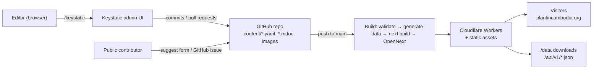

# Plant in Cambodia — Development Phases

> An open data platform listing the plants of Cambodia, in Khmer and English.
> Domain: **plantincambodia.org** · Repo: `github.com/HorngFu/Plant-in-Cambodia`

This document is the master plan. Each phase is small enough to build in one go, has a clear
"done" checklist, and ends with something you can see working.

---

## How to use this document

1. Check the **Phase tracker** below for the next phase that isn't done.
2. Do the **"You do"** items for that phase (accounts, decisions, secrets). I can't do these for you.
3. Ask me with the phase's ready-made prompt, for example:

   ```text
   Develop Phase 1 from docs/DEVELOPMENT_PHASES.md
   ```

4. When the phase is finished I will tick off its **Done when** list, update the tracker, and
   add a line to the **Changelog** at the bottom.

You can also ask for part of a phase ("Do Phase 3, only the plant detail page") or change the plan
("Move maps before open data"). Just say so and I'll update this file first.

---

## Phase tracker

| #  | Phase                                         | Who      | Status         |
|----|-----------------------------------------------|----------|----------------|
| 0  | Accounts, domain & decisions                  | You      | ⬜ Not started |
| 1  | Project setup & first deploy                  | Me + you | ⬜ Not started |
| 2  | Content model & Keystatic (local)             | Me       | ⬜ Not started |
| 3  | Public website (bilingual)                    | Me       | ⬜ Not started |
| 4  | Browse, filter & search                       | Me       | ⬜ Not started |
| 5  | Keystatic online (GitHub mode) & editing flow | Me + you | ⬜ Not started |
| 6  | Cambodia checklist import                     | Me       | ⬜ Not started |
| 7  | Open data: downloads & API                    | Me       | ⬜ Not started |
| 8  | Photos & distribution maps                    | Me       | ⬜ Not started |
| 9  | Community contributions                       | Me + you | ⬜ Not started |
| 10 | Launch readiness                              | Me + you | ⬜ Not started |
| 11 | Scale-up menu (pick when needed)              | Me + you | ⬜ Later       |

Status legend: ⬜ Not started · 🟨 In progress · ✅ Done · ⏸️ Paused

---

## 1. Vision

- **What:** A free, public, trustworthy list of the plants of Cambodia: scientific names, Khmer
  and English names, families, where they grow (by province and habitat), uses, conservation
  status, photos and references.
- **Who it's for:** students, teachers, researchers, NGOs, foresters, farmers, gardeners, and anyone
  curious about Cambodian plants.
- **Open data:** everything can be downloaded (JSON, CSV, GeoJSON, Darwin Core) under an open
  license, and the whole project lives in a public GitHub repo.
- **Free first:** costs nothing to run at the start except the domain (about $10/year). Every part
  has a clear way to scale up when traffic or content grows.

---

## 2. Recommended technology

| Need                 | Choice                                                  | Why                                                                                       | Free tier                                                                     |
|----------------------|---------------------------------------------------------|-------------------------------------------------------------------------------------------|-------------------------------------------------------------------------------|
| Code & content store | **GitHub** (public repo)                                | Content is plain files in Git: full history, reviews, and anyone can fork the data        | Free for public repos, incl. GitHub Actions                                   |
| CMS                  | **Keystatic**                                           | Edits files in the repo through a friendly admin UI; no database needed                   | Free (local + GitHub mode)                                                    |
| Framework            | **Next.js** (App Router, TypeScript)                    | Static pages for speed and SEO, plus API routes for Keystatic                             | Free                                                                          |
| Hosting              | **Cloudflare Workers** via the **OpenNext** adapter     | Cloudflare's recommended way to run Next.js; static files are served free and unlimited   | 100k worker requests/day; static assets unlimited                             |
| Domain & DNS         | **Cloudflare Registrar + DNS**                          | .org sold at cost, DNS and SSL free, everything in one dashboard                          | DNS/SSL free; domain ~$10–11/yr                                               |
| Styling              | **Tailwind CSS**                                        | Fast to build, small CSS output                                                           | Free                                                                          |
| Khmer + English      | **next-intl**, fonts **Kantumruy Pro** / **Noto Sans Khmer** | Mature i18n for the App Router; good Khmer web fonts                                 | Free                                                                          |
| Search               | Build-time JSON index + **Orama** or **FlexSearch** in the browser | No server needed; works offline; handles thousands of plants                   | Free                                                                          |
| Maps                 | Province **SVG/GeoJSON map** (geoBoundaries data), later **MapLibre + OpenFreeMap** | No tile costs or API keys                                     | Free                                                                          |
| Images (start)       | In the repo, pre-optimised to WebP by a script          | Simple; works with Keystatic out of the box                                               | Free                                                                          |
| Images (scale)       | **Cloudflare R2**                                       | No bandwidth fees, keeps the Git repo small                                               | 10 GB storage free                                                            |
| Spam protection      | **Cloudflare Turnstile**                                | Free, privacy-friendly CAPTCHA alternative                                                | Free                                                                          |
| Analytics            | **Cloudflare Web Analytics**                            | No cookies, no banner needed                                                              | Free                                                                          |
| Email                | **Cloudflare Email Routing**                            | `contact@plantincambodia.org` forwards to your Gmail                                      | Free                                                                          |
| Data validation      | **Zod** + a validation script run in CI                 | Stops broken or incomplete plant entries from being published                             | Free                                                                          |

> Free-tier numbers change. I'll re-check the current limits at the start of Phase 1.

### Architecture



### Two rules that keep it free and fast

1. **Every public page is generated at build time (static).** Plant content is read from files only
   during the build. Cloudflare Workers can't read the `content/` folder at runtime, so pages that
   read content at request time would break. Only `/keystatic` and `/api/keystatic` run live.
2. **Data files are generated at build time too.** The search index, downloads and the JSON API are
   plain files, so they cost nothing to serve and can be cached forever.

---

## 3. Cost plan

| Stage                         | What you pay                         | Trigger to move up                                                                      |
|-------------------------------|--------------------------------------|-----------------------------------------------------------------------------------------|
| **Start (now)**               | Domain only, ~$10–11/year            | —                                                                                       |
| **Growing**                   | + Workers Paid **$5/month**          | Over ~100k page views/day, the worker bundle grows past the free 3 MiB limit, or CPU limits are hit |
| **Lots of photos**            | + R2 beyond 10 GB (~$0.015/GB-month) | Photo library over 10 GB, or the Git repo over ~1 GB                                    |
| **Community features**        | D1 database (free tier is generous)  | User accounts, observations, comments                                                   |

---

## 4. Decisions (please confirm or change)

I've filled in my recommendation for each one. Reply with the numbers you want to change, for
example "D1: Khmer default, D2: CC0". Anything you don't change, I'll use as written.

| #   | Question                          | Recommendation                                                                                                     | Your answer |
|-----|-----------------------------------|--------------------------------------------------------------------------------------------------------------------|-------------|
| D1  | Languages and default             | Khmer **and** English from day one. URLs `/km/...` and `/en/...`; `/` picks from the browser language, otherwise English | |
| D2  | Data license                      | **CC BY 4.0** (free use with attribution; matches Kew/GBIF data we'll build on)                                      | |
| D3  | Code license                      | **MIT**                                                                                                              | |
| D4  | Which plants                      | **Vascular plants** (ferns, conifers, flowering plants), native **and** introduced/cultivated, clearly labelled. Fungi, mosses and algae later | |
| D5  | Two levels of entries             | **Yes:** *checklist entries* (name, family, status; thousands, imported) and *full profiles* (description, photos, uses; written by editors) | |
| D6  | GitHub owner                      | Keep `HorngFu/Plant-in-Cambodia` for now; move to a GitHub **organization** (e.g. `plantincambodia`) before inviting editors. GitHub redirects the old URL | |
| D7  | Who edits in Keystatic            | You plus a small trusted team (GitHub collaborators). The public suggests changes through a form (Phase 9)          | |
| D8  | Domain                            | Register `plantincambodia.org` on **Cloudflare Registrar** (or point your current registrar's nameservers to Cloudflare) | |
| D9  | Sensitive species locations       | **Province level only.** Never publish exact GPS points for threatened or poached species (e.g. rosewoods, orchids)   | |
| D10 | Look and feel                     | Clean, nature-inspired (forest green, warm neutrals), mobile first. Tell me if you have a logo, colours or sites you like | |
| D11 | Medicinal and edible info         | Allowed, always with a "not medical advice" note and a source reference. Toxic plants get a clear warning            | |

---

## 5. Data model (draft — finalised in Phase 2)

**Collections in Keystatic**

| Collection     | Purpose                                     | Key fields                                                                                                                 |
|----------------|---------------------------------------------|----------------------------------------------------------------------------------------------------------------------------|
| `plants`       | One entry per species (or infraspecies)     | see below                                                                                                                  |
| `families`     | Plant families                              | scientific name, Khmer/English name, order, short description                                                              |
| `provinces`    | Cambodia's 25 provinces/capital             | Khmer/English name, ISO code (`KH-12`, ...), boundary ID                                                                   |
| `habitats`     | Habitat types                               | e.g. evergreen forest, deciduous dipterocarp forest, mangrove, Tonle Sap floodplain, grassland, karst, urban/cultivated     |
| `references`   | Books, papers, websites                     | citation, URL/DOI, year                                                                                                    |
| `contributors` | People credited for content and photos      | name, role, link                                                                                                           |
| `pages`        | About, License, How to contribute, etc.     | title (km/en), body (km/en)                                                                                                |

**Plant fields**

- **Identity:** `slug`, `scientificName`, `author`, `rank` (species / subspecies / variety),
  `family` → families, `genus`, `synonyms[]`
- **Names:** `khmerName`, `khmerNameLatin` (romanised), `englishName`, `otherLocalNames[]`
- **Classification:** `growthForm` (tree, shrub, herb, climber, palm, bamboo, grass, fern,
  aquatic, epiphyte), `originStatus` (native, endemic, introduced, naturalised, invasive,
  cultivated), `iucnStatus` (NE, DD, LC, NT, VU, EN, CR, EW, EX)
- **Where:** `provinces[]` → provinces, `habitats[]` → habitats, `elevationMin/Max`,
  `isSensitive` (hides fine-grained location)
- **When:** `floweringMonths[]`, `fruitingMonths[]`
- **Uses:** `uses[]` (food, medicine, timber, fibre, ornamental, ritual/religious, fodder, dye,
  other), `toxicity` note
- **Text (km + en):** `summary`, `description`, `identification`, `usesNotes`
- **Media:** `images[]` → { file, caption, author, license, sourceUrl }
- **Links:** `gbifKey`, `powoId`, `wfoId`, `iucnId`, `inaturalistId`
- **Trust:** `references[]` → references, `profileLevel` (checklist / full), `reviewStatus`
  (draft / reviewed), `lastReviewed`, `contributors[]`

**File layout:** `content/plants/<slug>/index.yaml` plus one `.mdoc` file per long text field.
Plain text files keep changes easy to review on GitHub.

---

## 6. Planned repository layout

```text
Plant-in-Cambodia/
├── content/                 # All data — edited by Keystatic or by hand
│   ├── plants/<slug>/       # index.yaml + description.km.mdoc + description.en.mdoc ...
│   ├── families/  provinces/  habitats/  references/  contributors/  pages/
├── public/
│   ├── images/plants/<slug>/   # optimised photos (until moved to R2)
│   └── data/                   # generated at build: downloads, search index (git-ignored)
├── src/
│   ├── app/
│   │   ├── [locale]/           # km / en public pages
│   │   ├── keystatic/          # admin UI
│   │   └── api/keystatic/      # Keystatic auth/API route
│   ├── components/
│   ├── lib/content/            # typed readers over content/ (build time only)
│   └── i18n/                   # next-intl setup
├── messages/  km.json  en.json # UI text translations
├── scripts/                    # validate, build-data, import-checklist, optimise-images
├── docs/                       # this plan, data dictionary, contributor guide
├── keystatic.config.ts
├── wrangler.jsonc  open-next.config.ts
└── .github/workflows/          # CI: lint, typecheck, validate content, build
```

---

## 7. Phases

### Phase 0 — Accounts, domain & decisions *(you)*

**Goal:** Everything needed before I write code.

**You do**
- [ ] Answer or accept the decisions in section 4.
- [ ] Create a free **Cloudflare** account; enable 2FA.
- [ ] Register **plantincambodia.org** (Cloudflare Registrar recommended), or add the domain to
      Cloudflare and change your registrar's nameservers.
- [ ] Confirm the GitHub repo `HorngFu/Plant-in-Cambodia` is **public** (or tell me you want it private for now).
- [ ] Install on your PC: **Node.js LTS** (22 or newer), **Git**, **pnpm** (`npm i -g pnpm`).
- [ ] Optional: set up **Email Routing** for `contact@plantincambodia.org`.

**Done when:** domain shows "Active" in Cloudflare, decisions are answered, tools installed
(`node -v`, `pnpm -v` work).

**Ask me with:** `Phase 0 is done. Here are my decisions: ...` (or ask me to walk you through any step).

---

### Phase 1 — Project setup & first deploy

**Goal:** A "Coming soon" page live at **https://plantincambodia.org**, deployed automatically from GitHub.

**I do**
- Create the Next.js app (latest version supported by `@opennextjs/cloudflare`), TypeScript,
  Tailwind, ESLint + Prettier, pnpm.
- Add the OpenNext Cloudflare adapter, `wrangler.jsonc`, and scripts: `dev`, `preview`
  (local Workers runtime), `deploy`.
- Install Keystatic early and check the worker bundle stays **under the free 3 MiB limit**
  (if not, we switch to the fallback in Risks).
- Add `README.md`, `LICENSE` (code), `LICENSE-DATA` (content), `CONTRIBUTING.md`,
  `CODE_OF_CONDUCT.md`, `.editorconfig`, `.gitignore`.
- GitHub Actions CI: install → lint → typecheck → build on every pull request.
- Deploy setup: Cloudflare **Workers Builds** (Git integration) for `main` plus preview URLs for branches.
- Basic security headers and `robots.txt` (block indexing until launch).

**You do**
- Connect the GitHub repo in the Cloudflare dashboard (I'll give you click-by-click steps).
- Add the custom domain `plantincambodia.org` (and `www` → redirect) to the worker.

**Done when**
- [ ] `pnpm dev` runs locally.
- [ ] Pushing to `main` deploys automatically.
- [ ] https://plantincambodia.org shows the placeholder page with valid HTTPS.
- [ ] CI passes on a test pull request.

**Ask me with:** `Develop Phase 1 from docs/DEVELOPMENT_PHASES.md`

---

### Phase 2 — Content model & Keystatic (local)

**Goal:** You can add and edit plants on your own PC at `http://localhost:3000/keystatic`.

**I do**
- `keystatic.config.ts` with all collections from section 5 (local storage mode for now).
- Seed data: all 25 provinces, about 15 habitats, the most common families, and **10 sample plants**
  (well-known Cambodian species, e.g. Sralao, Beng, Koki, Thnot / sugar palm, lotus, Khmer rosewood).
- Typed content readers (`src/lib/content`) used at build time.
- `scripts/validate-content.ts`: Zod checks (required fields, valid relations, no duplicate
  scientific names, image license present, references for medicinal claims), run in CI.
- `docs/DATA_DICTIONARY.md` explaining every field in plain language.

**Done when**
- [ ] You can create, edit and delete a plant in the local Keystatic admin.
- [ ] Changes appear as readable files in `content/`.
- [ ] `pnpm validate` catches a deliberately broken entry.

**Ask me with:** `Develop Phase 2 from docs/DEVELOPMENT_PHASES.md`

---

### Phase 3 — Public website (bilingual)

**Goal:** A real, good-looking site in Khmer and English showing the sample plants.

**I do**
- next-intl with `/km` and `/en`, language switcher, Khmer fonts with correct line height.
- Design system: colours, typography, cards, tags (IUCN, native/introduced), responsive layout, dark mode.
- Pages:
  - **Home:** intro, featured plants, quick search box, numbers (species, families, photos).
  - **Plants list:** cards with photo, Khmer/English/scientific names.
  - **Plant detail:** names, taxonomy, status badges, description, uses, provinces, habitats,
    flowering calendar, references, external links (GBIF, POWO, IUCN), "suggest an edit" link,
    "how to cite this page".
  - **Family pages** and **province pages** (plants found in each).
  - **About**, **License & data use**, **Contribute** (from the `pages` collection).
- SEO: per-page titles and descriptions, Open Graph images, `hreflang`, sitemap.xml,
  JSON-LD (`Taxon` schema), canonical URLs.
- All pages statically generated (`generateStaticParams`).

**Done when**
- [ ] Every sample plant has a working page in both languages.
- [ ] Lighthouse scores of 90+ for Performance, Accessibility, SEO on mobile.
- [ ] Deployed and viewable on plantincambodia.org.

**Ask me with:** `Develop Phase 3 from docs/DEVELOPMENT_PHASES.md`

---

### Phase 4 — Browse, filter & search

**Goal:** Find any plant quickly by any name, in either language.

**I do**
- Build step that writes a compact search index to `public/data/search-index.json`.
- Browser search (Orama or FlexSearch) over scientific, Khmer, English and local names plus synonyms.
  - **Khmer has no spaces between words**, so Khmer fields use substring/n-gram matching.
  - Typo tolerance for Latin names; matches with or without diacritics.
- Filters: family, growth form, origin status, IUCN status, province, habitat, uses,
  flowering month, "has photos". Filters are kept in the URL so results can be shared.
- Sorting (scientific name, Khmer name, recently updated) and pagination / "load more".
- A–Z browse by scientific name and by family.
- Designed and tested for **5,000+ entries** (ready for Phase 6).

**Done when**
- [ ] Searching "ស្រឡៅ", "sralao" or "Lagerstroemia" finds the same plant.
- [ ] Combined filters work and the URL can be shared.
- [ ] Search stays fast with a generated 5,000-entry test dataset.

**Ask me with:** `Develop Phase 4 from docs/DEVELOPMENT_PHASES.md`

---

### Phase 5 — Keystatic online (GitHub mode) & editing flow

**Goal:** You and trusted editors edit content at **plantincambodia.org/keystatic** from any
browser. Each save goes to GitHub and the site rebuilds on its own.

**I do**
- Switch Keystatic to **GitHub mode** in production (local mode stays for development).
- Walk you through creating the Keystatic **GitHub App** and setting the secrets in Cloudflare.
- Check the Keystatic API route works on the Workers runtime.
- Editing flow: editors work on branches, open a pull request, CI validates content, Cloudflare
  builds a **preview URL**, a reviewer merges, and the site updates.
- Branch protection on `main` (required CI checks, at least 1 review).
- `docs/EDITOR_GUIDE.md`: how to add a plant, photo rules, sources, review checklist (with screenshots).

**You do**
- Create the GitHub App (guided), add secrets, invite editors as collaborators.

**Done when**
- [ ] You log in at `/keystatic` on the live site with GitHub.
- [ ] Editing a plant creates a branch or pull request with a preview URL.
- [ ] Merging updates the live site within a few minutes.

**Ask me with:** `Develop Phase 5 from docs/DEVELOPMENT_PHASES.md`

---

### Phase 6 — Cambodia checklist import

**Goal:** Go from 10 plants to a fairly complete list of Cambodia's vascular plants as *checklist entries*.

**I do**
- `scripts/import-checklist.ts` using the **World Checklist of Vascular Plants (WCVP, Kew, CC BY)**
  filtered to Cambodia (WGSRPD area code `CBD`; I'll verify it), cross-checked with GBIF names.
- Creates or updates checklist-level entries: accepted name, author, family, native/introduced
  status, synonyms, POWO/GBIF IDs. **Never overwrites** editor-written fields.
- Creates any missing families automatically.
- Dry-run mode with a report (new / changed / conflicts) before writing anything.
- Checklist pages look simpler, with a "Help write this profile" call to action.
- Attribution to sources on the License page and in downloads.

**Done when**
- [ ] Import runs again without creating duplicates (idempotent).
- [ ] Site builds and deploys with thousands of entries, and build time is acceptable.
- [ ] Search and filters work on the full list.

**Ask me with:** `Develop Phase 6 from docs/DEVELOPMENT_PHASES.md`

---

### Phase 7 — Open data: downloads & API

**Goal:** Anyone can download or programmatically use the data.

**I do**
- Generated at build time:
  - `/data/plants.json`, `/data/plants.csv` (UTF-8 with BOM so Khmer opens correctly in Excel)
  - `/data/families.csv`, `/data/provinces.geojson` (with plant counts)
  - **Darwin Core Archive** (`/data/dwca.zip`) for GBIF compatibility
- Read-only static JSON API: `/api/v1/plants.json`, `/api/v1/plants/{slug}.json`,
  `/api/v1/families/{slug}.json`, versioned and CORS-enabled.
- **Open Data** page: what's included, field dictionary, license, how to cite, changelog.
- `CITATION.cff` in the repo; GitHub releases (e.g. `data-v2026.12`) archived on **Zenodo** for a DOI.

**Done when**
- [ ] All downloads open correctly, Khmer included, in Excel, LibreOffice and Python.
- [ ] The DwC archive passes the GBIF data validator.
- [ ] API documented with examples (curl, JavaScript, Python, R).

**Ask me with:** `Develop Phase 7 from docs/DEVELOPMENT_PHASES.md`

---

### Phase 8 — Photos & distribution maps

**Goal:** Good photos with proper credit, and a map on every plant page.

**I do**
- `scripts/optimise-images.ts`: resize to standard widths, convert to WebP/AVIF, strip GPS EXIF
  (protects sensitive locations), keep originals out of Git.
- Photo gallery with lightbox and an attribution line on every image (author, license, source).
- Keystatic image field with required author and license.
- **Province map** of Cambodia (simplified geoBoundaries GeoJSON → lightweight SVG) highlighting
  where each plant occurs; a clickable country map on the Provinces page.
- Decide when to move photos to **Cloudflare R2** (trigger: repo over ~1 GB) and document how to migrate.

**Done when**
- [ ] Plant pages show photos and maps with no layout shift and good mobile performance.
- [ ] No photo is published without author and license.

**Ask me with:** `Develop Phase 8 from docs/DEVELOPMENT_PHASES.md`

---

### Phase 9 — Community contributions

**Goal:** People without GitHub accounts can suggest new plants, corrections and photos.

**I do**
- GitHub **issue forms** for: new plant, correction, photo submission, local name.
- On-site **"Suggest an edit"** form (Khmer/English) protected by **Turnstile**. A small Worker
  turns it into a GitHub issue using a bot token, so no personal data is published without consent.
- Labels and a triage guide for editors; "good first profile" list for volunteers.
- Contributors page crediting editors and photographers.

**You do**
- Create the Turnstile site key and the GitHub bot token (guided).

**Done when**
- [ ] A suggestion sent from the website shows up as a labelled GitHub issue.
- [ ] Spam is blocked; rate limiting is in place.

**Ask me with:** `Develop Phase 9 from docs/DEVELOPMENT_PHASES.md`

---

### Phase 10 — Launch readiness

**Goal:** Ready to announce publicly.

**I do**
- Accessibility pass (WCAG 2.2 AA): keyboard use, contrast, alt text, Khmer `lang` attributes.
- Performance pass: image sizes, font subsetting for Khmer, caching headers.
- Cloudflare Web Analytics; uptime monitoring.
- Custom 404/500 pages, `security.txt`, privacy page.
- Remove the `noindex`; submit the sitemap to Google Search Console and Bing.
- Check Khmer text in social share previews (Facebook and Telegram are big in Cambodia).
- Launch checklist and a short announcement text in Khmer and English.

**You do**
- Content review of the featured plants; verify the domain in Search Console; share the announcement.

**Done when**
- [ ] Launch checklist complete.
- [ ] Site indexed by search engines.

**Ask me with:** `Develop Phase 10 from docs/DEVELOPMENT_PHASES.md`

---

### Phase 11 — Scale-up menu *(pick items when needed)*

Ask for any item by name, e.g. `Develop Phase 11: R2 photo storage`.

| Item                       | When                                         | What                                                                     |
|----------------------------|----------------------------------------------|--------------------------------------------------------------------------|
| **R2 photo storage**       | Repo over ~1 GB or many photos               | Move images to R2 with a custom Keystatic field; image URLs on a CDN subdomain |
| **Workers Paid ($5/mo)**   | Over 100k requests/day, or bundle/CPU limits | Upgrade plan; enable caching of rendered pages                           |
| **Faster builds**          | Builds getting slow with many entries        | Incremental data generation, build caching                               |
| **Observations**           | Want sightings with dates and places         | D1 database + Worker API; sensitive species shown only at province level |
| **iNaturalist / GBIF sync**| Want live occurrence data                    | Scheduled Worker pulls Cambodia occurrences into maps                    |
| **User accounts**          | Community features                           | Auth on D1 (e.g. Better Auth), profiles, contribution history            |
| **Offline app (PWA)**      | Field use without internet                   | Installable app, offline plant list and photos                           |
| **Identification keys**    | Help people identify plants                  | Multi-access key by leaf, flower, fruit characteristics                  |
| **Server search**          | Over ~20k entries or full-text descriptions  | Orama Cloud / Typesense / Workers + D1 full-text search                  |
| **More groups**            | After vascular plants                        | Mosses, fungi, algae as separate collections                             |

---

## 8. Ways of working

- **Branches:** `main` is always deployable. Each phase is built on `phase-N-short-name` and merged by pull request.
- **Commits:** [Conventional Commits](https://www.conventionalcommits.org/) (`feat:`, `fix:`, `content:`, `docs:`).
- **Content changes** use the `content:` prefix so code and data history stay easy to tell apart.
- **Secrets** never go in Git. They live in Cloudflare (and `.dev.vars` locally, which is git-ignored).
- **Sources:** facts can be used from anywhere, but descriptions must be written in our own words
  (no copying from books or websites) and cite references.

---

## 9. Risks & mitigations

| Risk                                                                     | Mitigation                                                                                                            |
|--------------------------------------------------------------------------|-----------------------------------------------------------------------------------------------------------------------|
| Worker bundle over the free 3 MiB limit (Next.js + Keystatic)            | Measured in Phase 1. Fallback A: static export for the public site + Keystatic in local mode only. Fallback B: Workers Paid ($5/mo, 10 MiB limit) |
| Free CPU limit (10 ms) exceeded by live rendering                        | All public pages are prerendered static; only the Keystatic routes run live                                           |
| Git repo grows too big from photos                                       | Optimise images before commit; move to R2 at ~1 GB (Phase 11)                                                          |
| Build time grows with thousands of plants                                | Measured in Phase 6; incremental data generation if needed                                                             |
| Poaching risk from location data                                         | Province-level only for sensitive species; strip photo GPS EXIF                                                        |
| Wrong medicinal or edibility info harms someone                          | Required references, disclaimers, toxicity warnings, review before publishing                                          |
| Copyright problems from copied text or photos                            | Original writing only; required photo license and author; CC BY sources attributed                                     |
| Keystatic editors need GitHub accounts                                   | Fine for a small team; the public uses the suggestion form (Phase 9)                                                   |
| Khmer search quality                                                     | Substring/n-gram matching; test with real Khmer names                                                                 |

---

## 10. Changelog

| Date       | Change                                     |
|------------|--------------------------------------------|
| 2026-11-01 | Plan created.                              |
